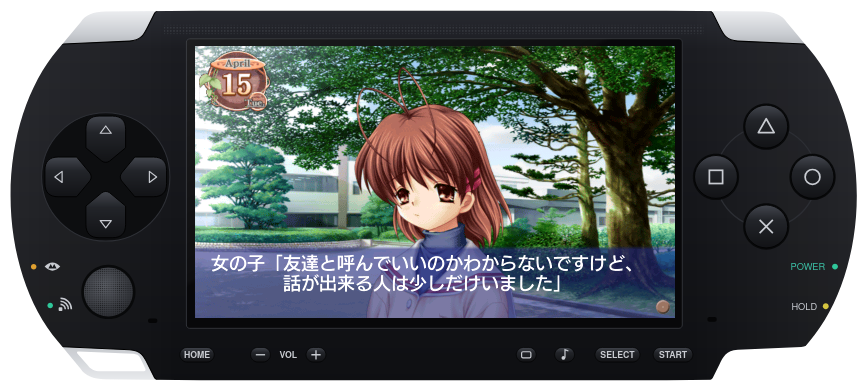
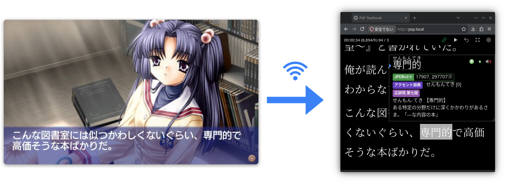

# psp-texthook
Learn Japanese on a PSP

  

psp-texthook is a collection of PRX plugins for the Sony PlayStation Portable that can hook text from PSP games, provide local access to popup dictionaries, and serve APIs over the network to integrate the PSP with an immersion learning workflow.

## What it does
- **Popup dictionary on the PSP itself.** Hit L+R and you get the current line over the game with JMdict entries for each word (conjugations included), plus VNDB character names.
- **Text page on your phone or PC.** Flip the Wi-Fi switch during gameplay and lines show up live on a web page served from the PSP (`http://psp.local/`, or scan the QR code it puts on screen). Comes with a reading timer, chars/hour, a pomodoro bar and regex replacements, and the session stays in sync across devices.
- **Screenshots** of the game over HTTP, and **Anki integration**: make a card while the page is open on your PC and a screenshot of the PSP's screen gets added to it automatically.

  

## Supported games
- 1/2 summer+ (NPJH50737)
- AIR (ULJM05282)
- Amagami (ULJS00339)
- CLANNAD (ULJM05338, ULJM05339)
- Himawari no Kyoukai to Nagai Natsuyasumi (ULJM06321)
- Kanon (ULJM05203)
- Little Busters! Converted Edition (ULJM05789, ULJM05790)
- Mashiro-iro Symphony *mutsu-no-hana (ULJM05889)
- SNOW Portable (ULJM05214)
- Suzumiya Haruhi no Yakusoku (ULJS00123, ULJS00124)
- Tomoyo After ~It's a Wonderful Life~ CS Edition (ULJM05411)
- your diary+ (NPJH50831)

Welcoming GitHub issues and PRs suggesting/adding hooks for new games.

## Credits

**Hooks and game research**
- [Agent](https://github.com/0xDC00/agent) and its [scripts](https://github.com/0xDC00/scripts): PPSSPP game hook scripts, referenced or flat out copied to guide implementation of many game hooks.
- [LunaHook](https://github.com/HIllya51/LunaTranslator) (part of LunaTranslator, GPL-3.0): the PPSSPP hook table that many other game scripts' hooks and filters are ported from.

**Dictionaries**
- [JMdict and KANJIDIC2](https://www.edrdg.org/) by the Electronic Dictionary Research and Development Group (CC BY-SA 4.0).
- [VNDB Names for Yomitan](https://github.com/kaanium/VNDB-Names-for-Yomitan) by kaanium (MIT), with names from [VNDB](https://vndb.org/) (ODbL).
- [Yomitan](https://github.com/yomidevs/yomitan), whose dictionary format the converter reads, and rikaichan, whose approach to deinflection the popup follows.

**Code and formats**
- [QR Code generator](https://github.com/nayuki/QR-Code-generator) by Project Nayuki (MIT): the URL's QR code on screen.
- [stb_image_write](https://github.com/nothings/stb) by Sean Barrett (public domain / MIT): JPEG screenshots.
- [PPSSPP](https://github.com/hrydgard/ppsspp) and [JPCSP](https://github.com/jpcsp/jpcsp): their documentation of the PGF font format, which the popup reads the PSP's own font with.
- The overlay's 8×8 font comes from the `cp850-8x8` console font of [kbd](https://kbd-project.org/).

**Platform**
- [PSPSDK and the pspdev toolchain](https://github.com/pspdev/pspsdk).
- [ARK](https://github.com/PSP-Archive/ARK-4) custom firmware, whose plugin and SystemControl APIs the kernel plugin is built on.

## Agent Use Disclosure
This project was built largely through the use of AI agents based on prior human-lead reverse engineering efforts in PSP game hooking. You can call it vibe-coded. Care was taken to iteratively test and verify features on real hardware (PSP-1000), but no guarantees are made in regards to code quality, efficiency, or safety. Things might break. You've been warned.
